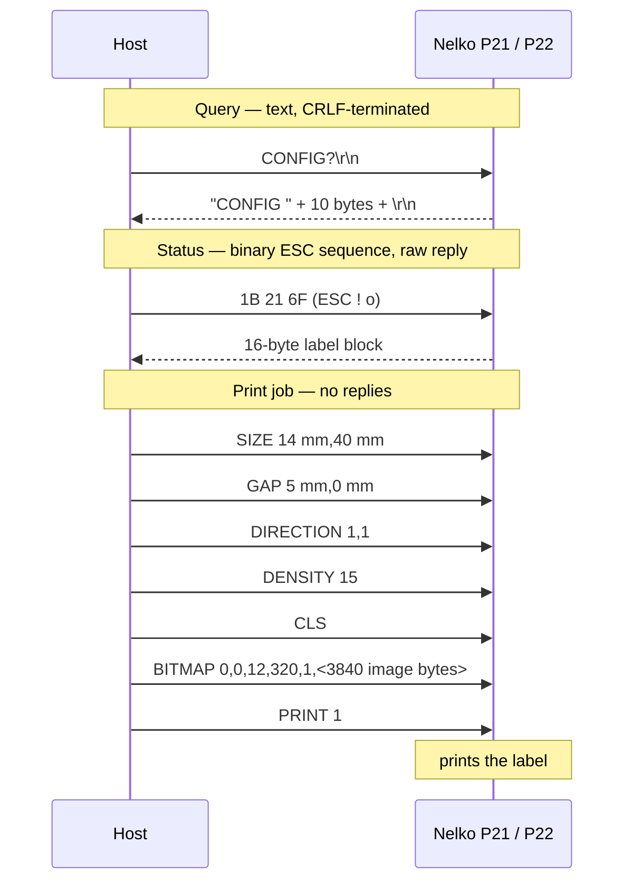

# Nelko P21 label printer — protocol and hardware notes

The Nelko P21 is a small Bluetooth thermal label printer. This repository documents its
communication protocol so you can print and query it without the official app, describes the
hardware inside it, and ships a Python script (`p21_print.py`) plus a Wireshark capture
(`nelko_bt_capture.pcapng`) of a real session — a connection and a print of the default template
on a 14 × 40 mm label.

The **Nelko P22 uses the same command protocol and data formats** — it is the same printer
firmware family and differs only in label geometry and version numbering, so everything below
applies to it too.

## Script usage

Pair the printer and open an RFCOMM connection (see [Bluetooth Classic](#bluetooth-classic-spp--rfcomm)
below), create a virtualenv, install `requirements.txt` with `pip`, and run `p21_print.py` — it
prints a help screen on start. Common uses:

```bash
$ python3 p21_print.py --status                 # loaded roll: type, size, colour, paper code
$ python3 p21_print.py --config                 # DPI, versions, timer, beep
$ python3 p21_print.py --battery                # charge level
$ python3 p21_print.py --image label.png        # print an image on the loaded label
```

## Transport

One line-based command protocol is reachable over two Bluetooth transports. The printer appears
on the air under the name **`P21`** (or `P22`), with a single public Bluetooth address used by
both transports. It beeps and its status LED turns blue whenever a Bluetooth link is made.

- **Bluetooth Classic (SPP / RFCOMM), channel 1** — the primary channel.
- **Bluetooth LE**, via GATT service `ff00` — the same commands and responses.

A USB CDC-ACM serial port is also exposed (`4c4a:4155`, "Jieli USB Composite Device"), but it
answers `ERROR0` to every command, with or without a terminator, so it is **not** a usable
command channel.

### Bluetooth Classic (SPP / RFCOMM)

This is the normal way to talk to the printer and what the official app uses. Power the printer
on, pair it with any Bluetooth tool (no PIN is required), then open an RFCOMM connection to
**channel 1**:

```bash
$ rfcomm connect /dev/rfcomm0 XX:XX:XX:XX:XX:XX
```

The printer only allows one SPP connection at a time. Once connected you send command bytes and
read replies as a plain serial stream. In Python a raw socket to channel 1 works without root and
without a `/dev/rfcomm0` tty:

```python
s = socket.socket(socket.AF_BLUETOOTH, socket.SOCK_STREAM, socket.BTPROTO_RFCOMM)
s.connect((MAC, 1))   # channel 1
s.sendall(b"CONFIG?\r\n")
print(s.recv(64))
```

Note on `/dev/rfcomm0`: with `release-on-hup` (blueman's default) the tty disappears when the
last program closes it, so `p21_print.py` keeps the port open for the whole run.

### Bluetooth LE

The printer also serves the exact same protocol over GATT, but it **only advertises and accepts
an LE connection while no classic link is up** (e.g. right after `bluetoothctl disconnect <MAC>`;
blueman reconnects the classic link within seconds, so connect immediately). Because its LE
address equals its classic address (public type), BlueZ's high-level APIs (e.g. `bleak`) treat it
as a classic device and may not list it as an LE peripheral — but a raw ATT socket connects
without root:

```python
s = socket.socket(socket.AF_BLUETOOTH, socket.SOCK_SEQPACKET, socket.BTPROTO_L2CAP)
s.bind(("00:00:00:00:00:00", 0, 4, 1))   # CID 4 = ATT, address type 1 = LE public
s.connect((MAC, 0, 4, 1))
```

GATT table (server MTU 23, so at most 20 bytes per write):

| Service | Characteristics |
|---|---|
| `1800` (GAP) | `2a00` device name, read/write |
| **`ff00`** (printer channel) | `ff02` (value handle `0x06`) write-without-response — **commands in**; `ff01` (`0x08`) notify — **answers out**; `ff04` (`0x0b`) write-without-response (same as `ff02`); `ff03` (`0x0d`) notify — flow-control credits; `ff05` (`0x10`) indicate; `ff10` (`0x13`) read/write |

To use the LE channel: write `0100` to the client-config descriptors (`0x09`, `0x0e`, `0x11`)
to enable notifications, then write the same command bytes you would send over serial to `ff02`;
the answer arrives as a notification on `ff01`, byte-for-byte identical to the serial answer.

`ff03` is a credit-based flow-control channel: when notifications are enabled the printer sends
`01 NN` ("you may send NN more packets", NN = 7 initially) and `02 LL LL` (little-endian payload
size per packet, 127 bytes). A 20-byte-per-write print job paced at ~12 ms per write prints fine
without managing credits. Pipelining many commands at once is unreliable — send one command at a
time and wait for its answer.

## Commands

The protocol has two kinds of message:

- **Text commands** are ASCII and terminated with CRLF (`\r\n`). The printer acts on the `\n`;
  a lone `\r` does nothing. Matching is case-insensitive and compares only the start of the line.
  Text responses end with CRLF.
- **Status commands** are raw `ESC` (`0x1B`) byte sequences and need no terminator; their
  responses are raw bytes with **no** CRLF.

This is the complete set of commands the printer accepts.

### Print / setup (no response)

| Command | Meaning |
|---|---|
| `SIZE w mm,h mm` | Label size in mm, e.g. `SIZE 14 mm,40 mm`. |
| `GAP g mm,0 mm` | Gap between labels in mm, e.g. `GAP 5 mm,0 mm`. |
| `DENSITY n` | Print darkness, `n` = 1..15. |
| `DIRECTION d,m` | Print direction `d` and mirror `m`. No visible effect observed on the P21. |
| `CLS` | Clear the image buffer. |
| `BITMAP x,y,wbytes,h,mode,<raw data>` | Load a 1-bpp bitmap at `x,y`; `wbytes` = width in **bytes**, `h` = height in **dots**, `mode` 1 = OR. Followed by the raw image bytes (see **Image format**). |
| `PRINT n` | Print `n` copies. Triggers the print; the printer sends no reply. |
| `SELFTEST` | Print the built-in self-test page. |
| `INITIALPRINTER` | Factory reset. |

### Settings (no text response; reflected in `CONFIG?`)

| Command | Meaning |
|---|---|
| `BEEP <b>` | Beep on/off. `<b>` is the raw byte `0x00`/`0x01`, not an ASCII digit. |
| `TIMER <b>` | Auto power-off. `<b>` is a raw byte: `0`=never, `1`=15 min, `2`=30 min, `3`=60 min. |

### Queries and status (have a response)

| Command | Bytes | Response |
|---|---|---|
| `CONFIG?` | text | `CONFIG ` + 10-byte payload + CRLF (see **CONFIG payload**). |
| `BATTERY?` | text | `BATTERY ` + 2 bytes + CRLF (see **BATTERY payload**). |
| `ESC ! ?` | `1B 21 3F` | 1 raw status byte (see **Status byte**). |
| `ESC ! o` | `1B 21 6F` | 16 raw bytes of label/NFC info (see **Label block**). |

A typical print job is the sequence `SIZE`, `GAP`, `DIRECTION`, `DENSITY`, `CLS`, `BITMAP`+data,
`PRINT` — none of which reply.



## Data formats

### CONFIG payload

`CONFIG?` returns `CONFIG ` followed by 10 bytes and CRLF:

| Bytes | Meaning | Example |
|---|---|---|
| 0–1 | DPI resolution, u16 big-endian | `00 cb` = 203 |
| 2–4 | hardware version | `00 00 03` = 0.0.3 |
| 5–7 | firmware version | `04 02 04` = 4.2.4 |
| 8 | shutdown timer (0=never, 1=15, 2=30, 3=60 min) | `01` |
| 9 | beep (0/1) | `01` |

A longer 20-byte variant carries an extra config-version byte; the fields above are unchanged.

### BATTERY payload

`BATTERY?` returns `BATTERY ` followed by 2 bytes and CRLF:

| Byte | Meaning |
|---|---|
| 0 | Charge level as BCD (`0x99` = 99 %). The printer reports 99 % whenever it is charging. |
| 1 | Charging flag (`1` = charging). |

### Status byte

`ESC ! ?` returns a single byte. It is a bitfield; `0x00` means ready. Known values:

| Value | Meaning |
|---|---|
| `0x00` | ready |
| `0x01` | lid open |
| `0x02` | feeding |
| `0x03` | paper error |
| `0x04` | no paper / not loaded |
| `0x10` | paused |
| `0x20` | busy |
| `0x24` | out of paper |
| `0x30` | low battery |
| `0x80` | overheated |
| `0x90` | no power |

Observed directly on a P21: `0x00` (ready) and `0x04` (no paper, roll disturbed / red lamp).

### Label block

`ESC ! o` returns 16 bytes describing the loaded label roll, read from its NFC tag. Example from
a genuine P21 roll: `00 0c 01 12 03 00 03 01 12 12 15 28 0f 0e ed 03`.

| Byte | Example | Meaning |
|---|---|---|
| 0 | `00` | Status byte (same encoding as above). |
| 1 | `0c` | Length of the tag data, always `0x0c` = 12. |
| 2–13 | `01 12 03 00 03 01 12 12 15 28 0f 0e` | The 12 tag bytes, also used as the roll's "paper code" (`011203000301121215280F0E`). |
| 3 | `12` | High nibble = tag format version (1); low nibble = trade/industry flag (2). |
| 4 | `03` | Paper colour: 2 transparent, 3 white, 4 pink, 5 blue, 6 yellow. |
| 5–6 | `00 03` | Roll batch number. |
| 7 | `01` | Paper type: 0 continuous, 1 gapped, 2 black-mark. |
| 8 | `12` | Gap in mm (for tag format ≥2; for format 1 it is not a gap). |
| 9 | `12` | Roll outer size (unit unknown). |
| 10 | `15` | Roll total length (unit unknown). |
| 11 | `28` | Label length in mm (40). |
| 12 | `0f` | Usable label width (15). |
| 13 | `0e` | Label width in mm (14). |
| 14–15 | `ed 03` | CRC16/MODBUS over bytes 0–13, big-endian. |

If no readable tag is present (e.g. the tag is covered), bytes 2–13 come back as zeros with a
valid CRC. A print with the tag covered worked identically to one with the tag read, so the
printer reports the tag but does not appear to require it.

### Image format

The bitmap carried by `BITMAP` is raw 1-bit-per-pixel data, MSB-first, with each row padded to a
whole number of bytes. A **0 bit prints black**, a 1 bit is white. There are no checksums.

For a 14×40 mm label the head image is **96 × 320 pixels** = 12 bytes per row × 320 rows:

- **Width: the print head is 96 dots = 12 mm wide** at 203 DPI, regardless of label width. A
  wider bitmap is clipped to the head (tested: a 16 mm / 128-dot ruler printed only its rightmost
  12 mm), so keep the width at 96 dots.
- **Length: the full label length is printable.** A 40 mm label prints end to end as
  `round(40 × 203 / 25.4)` = 320 dots — confirmed with a full-border test print, clean on all
  four edges with no clipping. (The official app uses a conservative 35.5 mm / 284 dots, but the
  printer prints the whole 40 mm.)

## Paper / label rolls

Each genuine roll carries an NFC tag that the printer reads when the lid closes. To identify the
loaded roll, send `ESC ! o` and decode the 16-byte **Label block** (above). The relevant fields:

**Paper type** (byte 7):

| Value | Type |
|---|---|
| 0 | continuous |
| 1 | gapped |
| 2 | black-mark |

**Paper colour** (byte 4):

| Value | Colour |
|---|---|
| 2 | transparent |
| 3 | white |
| 4 | pink |
| 5 | blue |
| 6 | yellow |

**Geometry** comes from the same block: byte 11 = label length in mm, byte 13 = label width in
mm, byte 8 = gap in mm (tag format ≥ 2). Bytes 2–13 together form the roll's **paper code** — a
12-byte identifier that uniquely describes the roll.

Known roll (the stock P21 roll):

| Paper code | Size | Type | Colour |
|---|---|---|---|
| `011203000301121215280F0E` | 14 × 40 mm | gapped | white |

To read the loaded roll with the script:

```bash
$ python3 p21_print.py --status      # prints type, size, colour and paper code
```

If the tag is missing or unreadable, bytes 2–13 come back as zeros; the printer still prints (it
reports the tag but does not require it), but you must then give the label size yourself
(`--label-size WxL`).

### A note on "DRM"

Nelko's rolls are sometimes described as having a copy-protection scheme. That **"soft DRM" lives
entirely in the official app, not in the printer**: the app takes the paper code (bytes 2–13 of
the label block) and looks it up against Nelko's server, and complains when it does not recognise
the roll. The printer firmware does no such check — it reads the NFC tag, reports it via
`ESC ! o`, and prints on whatever roll is loaded (including one with the tag covered, which reads
back as all-zeros). Driving the printer directly with this protocol therefore sidesteps the DRM
completely; you just supply the label size yourself when there is no usable tag.

## Chips inside the printer

The board is marked `P21 V2.2`. Main components:

| Ref | Part | Function |
|---|---|---|
| U3 | Jieli **AC6951C** (BR23 / AC695x family), LQFP48, with a 24 MHz crystal (Y1) and PCB antenna (ANT1) | Bluetooth SoC + printer controller |
| U4 | Yichip **YC5018** — 13.56 MHz RFID/NFC reader (ISO 14443A/B, MIFARE), QFN-32-EP, with a 27.12 MHz crystal (Y2 = 2× the carrier) | reads the label roll's NFC (NTAG-style) tag |
| U5 | `PT5139-HT` (TSSOP-16) | motor / stepper driver (paper feed) |
| U1 | TP4056 | Li-ion battery charger |
| — | 18650 Li-ion cell, 3.7 V, 1300 mAh | power |
| BE1 | magnetic buzzer | beeps |
| J2 | USB-C | charging + the CDC serial port (answers `ERROR0` only) |

The main SoC is a Jieli BR23-family part in an LQFP48 package (on-chip marking
`AC24BP1Y318-51C8`); the package and markings match the **AC6951C**. Reference material:

- [kagaimiq/jielie](https://github.com/kagaimiq/jielie) — community reverse-engineering docs for
  Jieli chips: the [BR23 page](https://github.com/kagaimiq/jielie/blob/master/chips/br23/index.md),
  the [BR23 I/O map](https://github.com/kagaimiq/jielie/blob/master/chips/br23/iomap.md), and the
  [chip-identification discussion](https://github.com/kagaimiq/jielie/pull/6) that first pointed to
  the AC6951C.
- [AC6951C datasheet V1.3](https://atta.szlcsc.com/upload/public/pdf/source/20230403/7B88A97065BC9B1575A68935B2AF5724.pdf) —
  pinout (Figure 1-1, page 4) and pin descriptions (page 5 onward).
- [Jieli-Tech/fw-AC63_BT_SDK](https://github.com/Jieli-Tech/fw-AC63_BT_SDK) — Jieli's public SDK
  for this chip family.
- Yichip YC5018 (the NFC reader, U4) — [LCSC / JLCPCB part C2916804](https://jlcpcb.com/partdetail/Yichip-YC5018/C2916804).
- PT5139 (the motor driver, U5, a dual H-bridge) — [datasheet](https://pdf.jiepei.com/pt5139-33489387.html), [LCSC part C336601](https://www.lcsc.com/product-detail/C336601.html).
- TP4056 (the Li-ion charger, U1) — [datasheet](https://www.mikrocontroller.net/attachment/273612/TP4056.pdf), [LCSC part C16581](https://www.lcsc.com/product-detail/C16581.html).

The firmware is built on Jieli's "SPP and LE transparent-data" example: the printer's SDP record
advertises a Serial Port (channel 1) and the 16-bit UUID `0xAF30`, which is the EIR UUID used by
that example, with Nelko's text command protocol layered on top of the serial channel.
